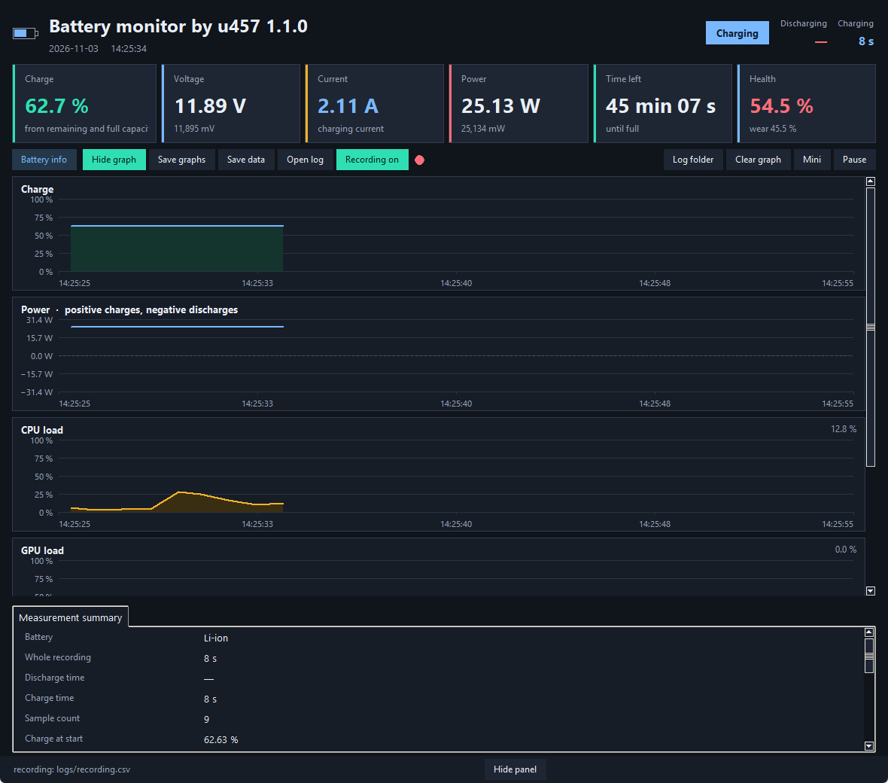

# Battery monitor by u457

Přenositelný program pro Windows, který živě ukazuje nabití, napětí, proud, výkon, vytížení CPU a GPU a zapisuje měření do CSV.

Portable Windows program that shows live charge, voltage, current, power, CPU and GPU load, and writes the measurement to CSV.

Na snímku je anglické rozhraní, protože na tom počítači je angličtina jako jazyk Windows. Jméno baterie, sériové číslo, cesty a název grafické karty jsou pryč. Stejné okno je na českých Windows česky.

The picture uses English because that computer’s Windows language is English. Battery name, serial number, paths and the graphics-card name are removed. On a Czech Windows the same window is in Czech.

## Co program dělá / What it does

- Živé nabití, napětí, proud, výkon, zbývající čas a kondice baterie.
- Grafy nabití, výkonu, CPU a GPU.
- Průběžný CSV záznam ve složce `logs`.
- Načtení logu s dobou vybíjení a nabíjení, spotřebovanou energií a nalezenými anomáliemi.
- Jazyk podle zobrazení Windows: čeština, slovenština, angličtina, němčina, polština, francouzština a španělština. Jiný jazyk Windows použije angličtinu.
- Po startu se podívá na vydání na GitHubu. Novou verzi lze nainstalovat, odložit, nebo tuto verzi přeskočit.

- Live charge, voltage, current, power, time remaining and battery health.
- Graphs for charge, power, CPU and GPU.
- A continuous CSV log in the `logs` folder.
- Opening a log shows discharge and charge time, energy used and anomalies.
- Language follows the Windows display language: Czech, Slovak, English, German, Polish, French and Spanish. Any other Windows language uses English.
- After startup it looks for a GitHub release. A new version can be installed, postponed, or skipped.

## Spuštění / Start

Potřebujete Windows a Python 3.8 nebo novější, včetně tkinter. Když Python chybí, `install.bat` ho umí stáhnout.

You need Windows and Python 3.8 or newer, including tkinter. If Python is missing, `install.bat` can download it.

1. Rozbalte složku kamkoli. / Unzip the folder anywhere.
2. Jednou spusťte `install.bat`. / Run `install.bat` once.
3. Dál spouštějte `run.bat` nebo `BatteryMonitor.vbs`. / After that, start `run.bat` or `BatteryMonitor.vbs`.

Logy zůstávají ve složce `logs` vedle programu. Uložené grafy jsou ve složce `grafy`.

Logs stay in the `logs` folder next to the program. Saved graphs go to `grafy`.

## Aktualizace / Updates

Když je na GitHubu novější vydání, program se zeptá.

When a newer GitHub release exists, the program asks.

- **Aktualizovat / Update** — stáhne vydání, zavře program a nahradí soubory programu. Složky `logs` a `grafy` zůstanou.
- **Později / Later** — zeptá se znovu při příštím spuštění.
- **Přeskočit tuto verzi / Skip this version** — tuto verzi už nenabídne. Novější verze se ozve normálně.

The update keeps the `logs` and `grafy` folders. Skip applies only to that version.

## Verze / Version

1.1.0

Repozitář / Repository: https://github.com/uzivatel457/battery-monitor
